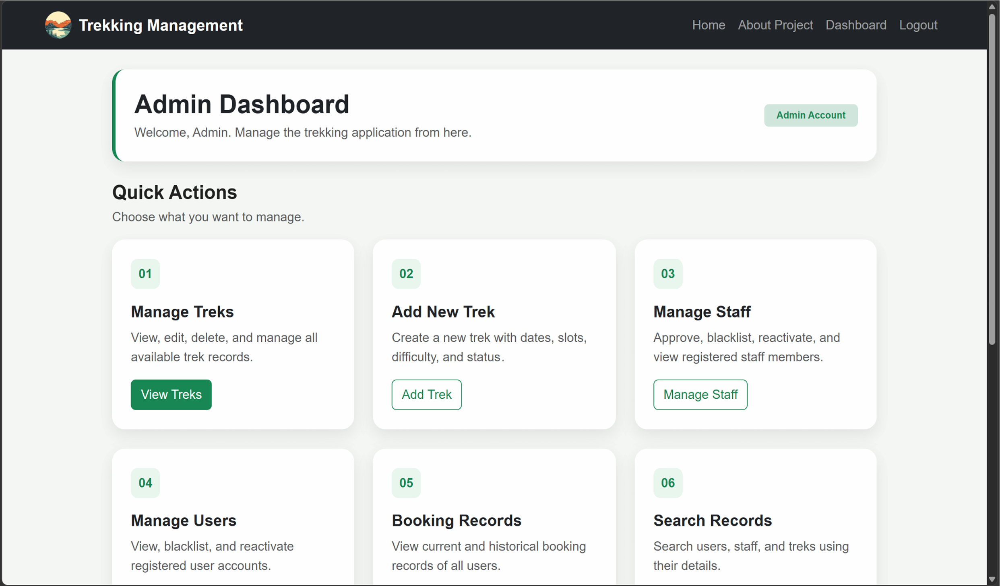
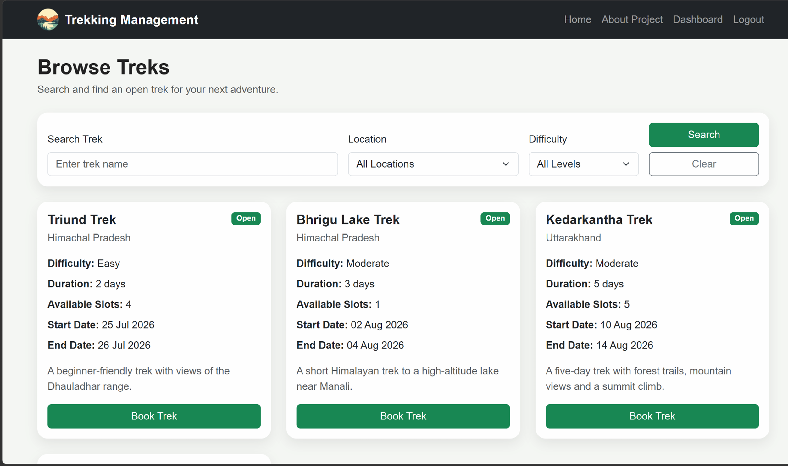

# Trekking Management Application

A role-based trekking management web application built using Flask, SQLite, and SQLAlchemy. The application allows administrators to manage treks and staff, while users can explore, book, and manage trekking activities.

## Features

- User registration and login with secure password hashing
- Role-based access control for Admin, Staff, and Users
- Admin dashboard for managing treks, users, and staff
- Staff registration approval and trek assignments
- Trek creation, updating, and deletion
- Trek browsing, searching, and filtering
- Trek booking and cancellation with automatic slot management
- Booking history and profile management
- Validation to prevent duplicate bookings and overbooking
- Responsive user interface

## Tech Stack

- **Frontend:** HTML, CSS, Bootstrap, Jinja2
- **Backend:** Python, Flask
- **Database:** SQLite
- **ORM:** SQLAlchemy
- **Authentication:** Flask Sessions, Werkzeug

## Screenshots

### Admin Dashboard


### Available Treks


## Getting Started

Clone the repository and navigate to the project directory.

Install the required Python dependencies and start the Flask application:

```bash
python app.py
```

The application uses SQLite for database management.
